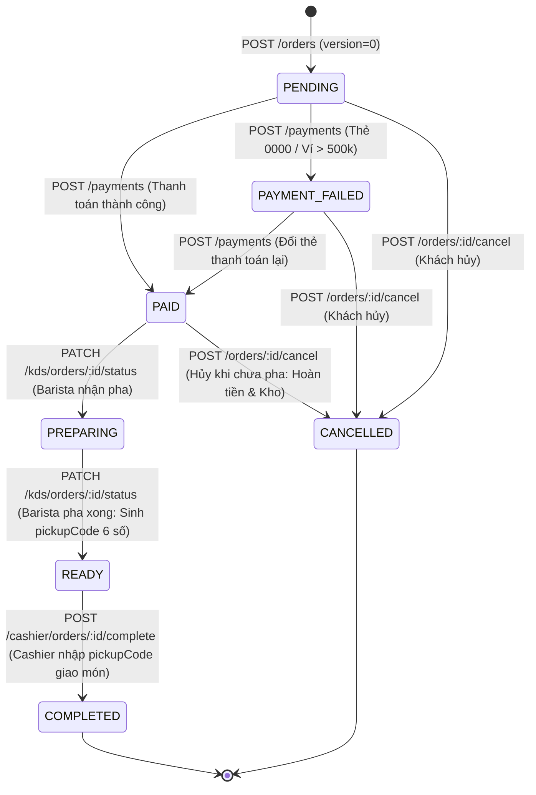

<div align="center">

# ☕ BREWLITE — Cashless Coffee Ordering & Operations Platform

### 🚀 Nền Tảng Đặt Cà Phê Không Tiền Mặt & Quản Vận Hành F&B Chuỗi

[](https://nextjs.org/)
[](https://nestjs.com/)
[](https://www.prisma.io/)
[](https://www.postgresql.org/)
[](https://www.docker.com/)
[](https://vitest.dev/)
[](https://github.com/Longcodepro/Project_SE_Assignment02_HK1_2026_2027/actions)

<p align="center">
  <b>Đồ án môn học:</b> Công nghệ Phần mềm (Software Engineering) — Assignment 2 (Requirements to Production Deployment)<br>
  <b>Học kỳ 1, Năm học 2026–2027 · Khoa Công nghệ Thông tin · Trường Đại học Sài Gòn (SGU)</b>
</p>

<p align="center">
  <a href="https://se-as2-brewlite.vercel.app">
    
  </a>
  <a href="https://brewlite-api.onrender.com/docs">
    
  </a>
  <a href="#-4-hướng-dẫn-khởi-chạy-1-lệnh-docker-compose">
    
  </a>
  <a href="#-5-chứng-chỉ-kiểm-thử-tự-động-testing--qa">
    
  </a>
</p>

---

### 🟢 TRẠNG THÁI HỆ THỐNG TRỰC TUYẾN (PRODUCTION CLOUD 24/7)

| Thành Phần | Hạ Tầng Đám Mây | Trạng Thái | Địa Chỉ Trực Tiếp |
|:---|:---:|:---:|:---|
| 🌐 **Frontend Web App** | Vercel Edge Network |  | [https://se-as2-brewlite.vercel.app](https://se-as2-brewlite.vercel.app) |
| 🚀 **Backend API Service** | Render Cloud (Singapore) |  | [https://brewlite-api.onrender.com](https://brewlite-api.onrender.com) |
| 📖 **Swagger OpenAPI 3.0** | Interactive Documentation |  | [https://brewlite-api.onrender.com/docs](https://brewlite-api.onrender.com/docs) |
| 🗄️ **Database Cloud** | Neon Serverless PostgreSQL |  | `ap-southeast-1.aws.neon.tech` (SSL) |
| 🛡️ **CI/CD Quality Gate** | GitHub Actions |  | [CI Workflow Runs](https://github.com/Longcodepro/Project_SE_Assignment02_HK1_2026_2027/actions) |

</div>

---

## 📑 Mục Lục
1. [🌟 Giới Thiệu Dự Án & Vai Trò](#-1-giới-thiệu-dự-án--vai-trò)
2. [💡 Điểm Sáng Kỹ Thuật (Engineering Highlights)](#-2-điểm-sáng-kỹ-thuật-engineering-highlights)
3. [📊 Máy Trạng Thái & Kiến Trúc Hệ Thống](#-3-máy-trạng-thái--kiến-trúc-hệ-thống)
4. [🚀 Hướng Dẫn Khởi Chạy (1 Lệnh Docker Compose)](#-4-hướng-dẫn-khởi-chạy-1-lệnh-docker-compose)
5. [🧪 Kiểm Thử Tự Động (600+ Tests Green)](#-5-kiểm-thử-tự-động-testing--qa)
6. [👤 Tài Khoản Mẫu Để Dùng Thử (Demo Accounts)](#-6-tài-khoản-mẫu-để-dùng-thử-demo-accounts)
7. [📁 Cấu Trúc Monorepo & Giải Thích](#-7-cấu-trúc-monorepo--giải-thích)
8. [📚 Hệ Thống Tài Liệu Kỹ Thuật](#-8-hệ-thống-tài-liệu-kỹ-thuật)

---

## 🌟 1. Giới Thiệu Dự Án & Vai Trò

### 1.1. Bối cảnh & Vấn đề giải quyết
**BrewLite** là nền tảng quản trị và bán hàng đa kênh O2O (Online-to-Offline) dành cho chuỗi đồ uống, giải quyết bài toán cốt lõi:
- **Khách hàng:** Đặt món không tiền mặt, tùy biến kích cỡ/topping, áp voucher, theo dõi đơn thời gian thực, nhận món qua mã định danh an toàn và tích điểm đổi quà.
- **Vận hành quầy & bếp (KDS):** Màn hình hiển thị bếp thời gian thực cho Barista theo dõi thứ tự pha chế, hạn chế sai sót và trễ đơn.
- **Thu ngân (Cashier):** Đối soát mã lấy hàng (`pickupCode`) 6 chữ số chống giao nhầm món cho khách.
- **Quản lý (Manager):** Quản lý thực đơn linh hoạt, trừ kho nguyên liệu tự động theo công thức định lượng (Bill of Materials - BOM) và báo cáo doanh thu chi tiết.

### 1.2. Phân công vai trò dự án
| Thành viên | Vai trò | Trách nhiệm chính |
|---|---|---|
| **Nguyễn Thành Long** (`@Longcodepro`) | **Backend Lead, Scrum Master, DevOps** | Thiết kế kiến trúc Modular Monolith NestJS, CSDL PostgreSQL/Prisma, Xử lý giao dịch & Concurrency (Idempotency, Optimistic Locking, BOM Deduction), Quản lý State Machine, CI/CD Pipeline, Bộ test tự động (520+ Vitest + Postman E2E). |
| **Trần Quốc Tài** (`@TaiTran263`) | **Frontend Developer, UI/UX** | Xây dựng giao diện Web & KDS PWA Mobile-first bằng Next.js 16, Tailwind CSS, Quản trị trạng thái giỏ hàng Zustand, tích hợp REST API. |

---

## 💡 2. Điểm Sáng Kỹ Thuật (Engineering Highlights)

Dự án được xây dựng với tư duy kỹ thuật chuyên sâu của một sản phẩm Enterprise-ready, áp dụng các mẫu kiến trúc giải quyết các bài toán hóc búa trong phân hệ giao dịch và vận hành:

### 🔒 2.1. Kiểm Soát Tranh Chấp Bằng Khóa Lạc Quan (Optimistic Concurrency Control - OCC)
* **Vấn đề:** Khi nhiều người dùng/nhân viên cùng thao tác lên một đơn hàng tại cùng thời điểm (ví dụ: Khách bấm Hủy đơn đúng khoảnh khắc Barista bấm Nhận pha chế).
* **Giải pháp:** Sử dụng cột `version` (INT) tăng dần trong bảng `Order`. Cập nhật trạng thái bằng câu lệnh SQL nguyên tử:
  ```sql
  UPDATE "Order"
  SET status = :nextStatus, version = version + 1
  WHERE id = :id AND version = :clientVersion AND status = :expectedStatus;
  ```
  Nếu số dòng cập nhật = 0 (phát hiện xung đột phiên bản), Backend lập tức ném lỗi **`409 Conflict`**, bảo vệ tuyệt đối tính toàn vẹn trạng thái.

### 🛡️ 2.2. Cơ Chế Chống Trùng Lặp Giao Dịch (Idempotency-Key Pattern)
* **Vấn đề:** Hiện tượng mạng chập chờn, timeout kết nối hoặc người dùng bấm đúp nút "Thanh toán" / "Đặt hàng" dẫn đến việc trừ tiền 2 lần hoặc tạo 2 đơn trùng lặp.
* **Giải pháp:** Áp dụng chuẩn header `Idempotency-Key: <unique-uuid>`. Backend lưu kết quả giao dịch đầu tiên vào bộ nhớ; mọi request đến sau có cùng khóa sẽ trả lại ngay kết quả của giao dịch trước đó mà không thực thi lại logic trừ tiền hay trừ kho.

### 📦 2.3. Trừ Kho Tự Động Theo Định Lượng (Bill of Materials - BOM Transaction)
* Khi đơn hàng chuyển sang `PAID`, hệ thống tự động bóc tách từng món trong đơn, tra cứu định lượng nguyên liệu (`Recipe`) tương ứng với từng Size/Topping (ví dụ: 1 Cà phê sữa Size L = 25g Hạt cà phê + 40ml Sữa đặc + 1 Ly nhựa L).
* Toàn bộ thao tác trừ kho diễn ra trong một **Prisma Database Transaction** (`prisma.$transaction`). Nếu bất kỳ nguyên liệu nào không đủ tồn kho, toàn bộ giao dịch được Rollback an toàn, trả mã lỗi cảnh báo rõ ràng.

### 🔄 2.4. Máy Trạng Thái Đơn Hàng Nghiêm Ngặt (Strict Finite State Machine)
* Ngăn chặn hoàn toàn việc bypass trạng thái (ví dụ: Không thể nhảy từ `PENDING` sang `READY` mà bắt buộc phải qua `PAID` và `PREPARING`).
* Khi đơn đã bước vào pha chế (`PREPARING`), hệ thống **khóa quyền hủy đơn** của khách hàng để tránh tổn thất nguyên vật liệu cho quán.

### 🔑 2.5. Bảo Mật & Phân Quyền 5 Cấp Độ (Role-Based Access Control - RBAC)
* Phân quyền chặt chẽ 5 nhóm quyền: `CUSTOMER`, `BARISTA`, `CASHIER`, `MANAGER`, `ADMIN`.
* Kết hợp NestJS `JwtAuthGuard` và Custom `RolesGuard` với metadata decorator `@Roles(...)`.
* Mật khẩu được băm bảo mật bằng `bcryptjs` với salt rounds chuẩn; lọc bỏ hoàn toàn `passwordHash` ở tầng Serialization trước khi trả về Client.

---

## 📊 3. Máy Trạng Thái & Kiến Trúc Hệ Thống

### 3.1. Sơ đồ Máy trạng thái Đơn hàng (Order State Machine)
Vòng đời đơn hàng từ khi khởi tạo đến khi hoàn tất hoặc hủy:



> 📖 *Xem toàn bộ 7 sơ đồ UML (Use-case, Activity, Sequence, Class Domain, Deployment) tại [docs/diagrams/README.md](./docs/diagrams/README.md).*

---

## 🚀 4. Hướng Dẫn Khởi Chạy (1 Lệnh Docker Compose)

Hệ thống được thiết kế theo chuẩn Twelve-Factor App, đóng gói trọn gói toàn bộ Frontend, Backend API và PostgreSQL Database chỉ với 1 câu lệnh.

### 4.1. Khởi chạy bằng Docker Compose (Khuyên dùng)
**Yêu cầu:** Máy đã cài đặt Docker & Docker Compose.

```bash
# 1. Clone repository
git clone https://github.com/Longcodepro/Project_SE_Assignment02_HK1_2026_2027.git
cd Project_SE_Assignment02_HK1_2026_2027

# 2. Khởi tạo biến môi trường từ mẫu
cp .env.example .env

# 3. Khởi động toàn bộ cụm dịch vụ (Web, API, Database)
docker compose up -d --build
```

Sau khi các container khởi động, hệ thống sẵn sàng tại:

| Dịch vụ | URL Local | Mô tả |
|---|---|---|
| 🌐 **Frontend Web App** | [http://localhost:4004](http://localhost:4004) | Giao diện đặt món cho khách |
| 🧑‍🍳 **Màn hình Bếp KDS** | [http://localhost:4004/kds](http://localhost:4004/kds) | Dành cho Barista pha chế |
| 🏢 **Trang Quản trị Admin** | [http://localhost:4004/admin](http://localhost:4004/admin) | Quản lý kho, menu, giá bán, báo cáo |
| 🚀 **Backend API** | [http://localhost:4003](http://localhost:4003) | NestJS REST API Server |
| 📖 **Swagger OpenAPI Docs** | [http://localhost:4003/docs](http://localhost:4003/docs) | Tài liệu tương tác API trực quan |
| 🗄️ **PostgreSQL 16 DB** | `localhost:4005` | CSDL lưu trữ chính |

*Để dừng hệ sinh thái:* `docker compose down` *(hoặc `docker compose down -v` để xóa sạch dữ liệu)*.

---

### 4.2. Khởi chạy từng dịch vụ trực tiếp (Local Development)
**Yêu cầu:** Node.js v20+ và PostgreSQL đang chạy cục bộ tại port 4005.

```bash
# 1. Chạy Backend API
cd apps/api
npm ci
npx prisma migrate deploy
npx prisma db seed
PORT=4003 npm run start:dev

# 2. Chạy Frontend Web (Mở terminal mới)
cd apps/web
npm ci
NEXT_PUBLIC_API_URL=http://localhost:4003 npm run dev
```

---

## 🧪 5. Kiểm Thử Tự Động (Testing & QA)

Dự án áp dụng kim tự tháp kiểm thử nghiêm ngặt với độ phủ rộng khắp mọi tầng:

<div align="center">

| Cấp độ kiểm thử | Công cụ | Số lượng kiểm thử | Trạng thái |
|:---:|:---:|:---:|:---:|
| **Backend Unit & Integration** | **Vitest** | **24 Test Files · 526 Tests** |  |
| **Frontend Store & Logic** | **Vitest** | **10 Test Files · 91 Tests** |  |
| **E2E API Test Suite** | **Newman / Postman** | **25 Scenarios (Chained Data)** |  |
| **E2E Browser Workflow** | **Playwright** | **Full Checkout Flow** |  |

</div>

### Lệnh thực thi kiểm thử:

```bash
# 1. Chạy 526 Unit test Backend
cd apps/api
npm test

# 2. Chạy 91 Unit test Frontend
cd apps/web
npm test

# 3. Chạy toàn bộ 25 kịch bản E2E Postman tự động qua Newman CLI (Yêu cầu API đang chạy)
cd apps/api
npm run postman

# 4. Kiểm tra mã nguồn (Linter & TypeCheck)
cd apps/api && npm run lint && npm run build
cd apps/web && npm run lint && npm run build
```

> 📖 *Xem chi tiết ma trận 25 kịch bản kiểm thử Postman tại [apps/api/postman/README.md](./apps/api/postman/README.md).*

---

## 👤 6. Tài Khoản Mẫu Để Dùng Thử (Demo Accounts)

Hệ thống đã nạp sẵn (seed) tài khoản thử nghiệm cho từng vai trò nghiệp vụ để người phỏng vấn / đánh giá kiểm tra tính năng nhanh chóng:

| Vai trò | Số điện thoại | Mật khẩu | Phạm vi quyền & Trang trải nghiệm |
|---|:---:|:---:|---|
| **Khách hàng (Customer)** | `0912345678`<br>hoặc `0987654321` | `matkhau123` | Đặt món tại `/`, xem giỏ hàng `/cart`, thanh toán `/checkout`, lịch sử đơn `/orders`, tích điểm loyalty. |
| **Pha chế (Barista)** | `0900000001` | `matkhau123` | Màn hình Bếp KDS tại `/kds` (Xem đơn pha chế, đổi trạng thái sang `PREPARING` $\rightarrow$ `READY`). |
| **Thu ngân (Cashier)** | `0900000002` | `matkhau123` | Nhập mã nhận hàng 6 số (`pickupCode`) để giao món và chuyển đơn sang `COMPLETED`. |
| **Quản lý (Manager)** | `0900000003` | `matkhau123` | Trang Quản trị tại `/admin` (Quản lý Menu `/admin/menu`, Kho nguyên liệu `/admin/inventory`, Báo cáo doanh thu). |

### Kịch bản thanh toán thẻ thử nghiệm:
* **Thanh toán Thành công:** Nhập số thẻ bất kỳ (16 số) có 4 số cuối **khác `0000`** (Ví dụ: `4111 2222 3333 4444`).
* **Thanh toán Thất bại:** Nhập số thẻ có 4 số cuối là **`0000`** (Ví dụ: `4111 2222 3333 0000`).

---

## 📁 7. Cấu Trúc Monorepo & Giải Thích

```
Project_SE_Assignment02_HK1_2026_2027/
|-- apps/
|   |-- api/                       # Máy chủ Backend NestJS 12
|   |   |-- prisma/                # Schema Prisma, migrations & seed.ts
|   |   |-- src/
|   |   |   |-- auth/              # JWT authentication, bcrypt & RBAC RolesGuard
|   |   |   |-- orders/            # Đặt đơn, tính giá server-side, OCC & state machine
|   |   |   |-- payments/          # Cổng thanh toán mô phỏng (Card/Wallet) & Idempotency
|   |   |   |-- kds/               # Kitchen Display System cho Barista
|   |   |   |-- cashier/           # Xác thực pickupCode & hoàn tất đơn
|   |   |   |-- inventory/         # Quản lý kho & công thức định lượng (BOM)
|   |   |   |-- menu/              # Quản trị sản phẩm, giá bán, size & topping
|   |   |   |-- promotions/        # Mã giảm giá (Vouchers) & validation
|   |   |   |-- loyalty/           # Tích điểm thành viên (1 điểm / 1.000đ)
|   |   |   `-- reports/           # Thống kê doanh thu, tỷ lệ hủy & top sản phẩm
|   |   `-- postman/               # Collection E2E, Environment & Hướng dẫn Newman
|   `-- web/                       # Giao diện Web Next.js 16 (App Router)
|       |-- src/app/               # Trang ứng dụng (/, /cart, /checkout, /kds, /admin)
|       |-- src/components/        # UI Components tái sử dụng
|       |-- src/store/             # Quản lý trạng thái Client (Zustand Cart Store)
|       `-- src/services/          # Tầng gọi API qua Axios
|-- docs/                          # Kho tài liệu kỹ thuật hoàn chỉnh
|   |-- diagrams/                  # 7 Sơ đồ UML (PlantUML, SVG, PNG & README)
|   |-- requirements/              # SRS rút gọn, User Stories & Đặc tả Use-case
|   |-- architecture/              # Kiến trúc Frontend/Backend, Hợp đồng API & ADRs
|   |-- deployment.md              # Chiến lược triển khai Production & Rollback khẩn cấp
|   |-- traceability-matrix.md     # Ma trận truy vết 21 Yêu cầu Chức năng (FR) + 5 NFR
|   `-- release-notes.md           # Ghi chú phát hành phiên bản chính thức
|-- tests/e2e/                     # Kiểm thử End-to-End trình duyệt (Playwright)
|-- .github/workflows/             # Tự động hóa CI/CD (Quality Gate & Continuous Deploy)
|-- docker-compose.yml             # Đóng gói khởi chạy trọn gói 1 câu lệnh
|-- .env.example                   # Biến môi trường mẫu chuẩn Twelve-Factor
`-- README.md                      # Bản đặc tả dự án toàn diện
```

---

## 📚 8. Hệ Thống Tài Liệu Kỹ Thuật

Dự án lưu trữ hệ thống tài liệu đồ sộ, đáp ứng đầy đủ tiêu chuẩn công nghiệp phần mềm:
* **Hệ thống sơ đồ thiết kế (Diagrams Gallery):** [docs/diagrams/README.md](./docs/diagrams/README.md) *(Bao gồm 7 sơ đồ UML tổng thể và toàn bộ sơ đồ chi tiết các phân hệ KDS, Cancel, Payments, Orders, Auth, Database)*
* **Kho báo cáo học thuật (Reports PDF):** [docs/reports/](./docs/reports/)
  - [Báo Cáo Nghiệm Thu Assignment 2 (report_asignment_2.pdf)](./docs/reports/report_asignment_2.pdf)
  - [Đề Bài Đặc Tả Assignment 2 (Assignment2-BrewLite.pdf)](./docs/reports/Assignment2-BrewLite.pdf)
* **Kế hoạch triển khai & Khôi phục sự cố (Rollback):** [docs/deployment.md](./docs/deployment.md)
* **Hợp đồng giao tiếp API (API Contract):** [docs/architecture/api-contract.md](./docs/architecture/api-contract.md)
* **Các quyết định kiến trúc (ADRs):** [docs/architecture/adr/](./docs/architecture/adr/)
* **Ma trận truy vết yêu cầu (Traceability Matrix):** [docs/traceability-matrix.md](./docs/traceability-matrix.md)
* **Bản ghi chú phát hành v1.0.0:** [docs/release-notes.md](./docs/release-notes.md)
* **Cẩm nang kiểm thử Postman E2E:** [apps/api/postman/README.md](./apps/api/postman/README.md)

---

<div align="center">
  <b>BrewLite — Xây dựng với tinh thần Software Engineering chuyên nghiệp và chuẩn mực.</b>
</div>
