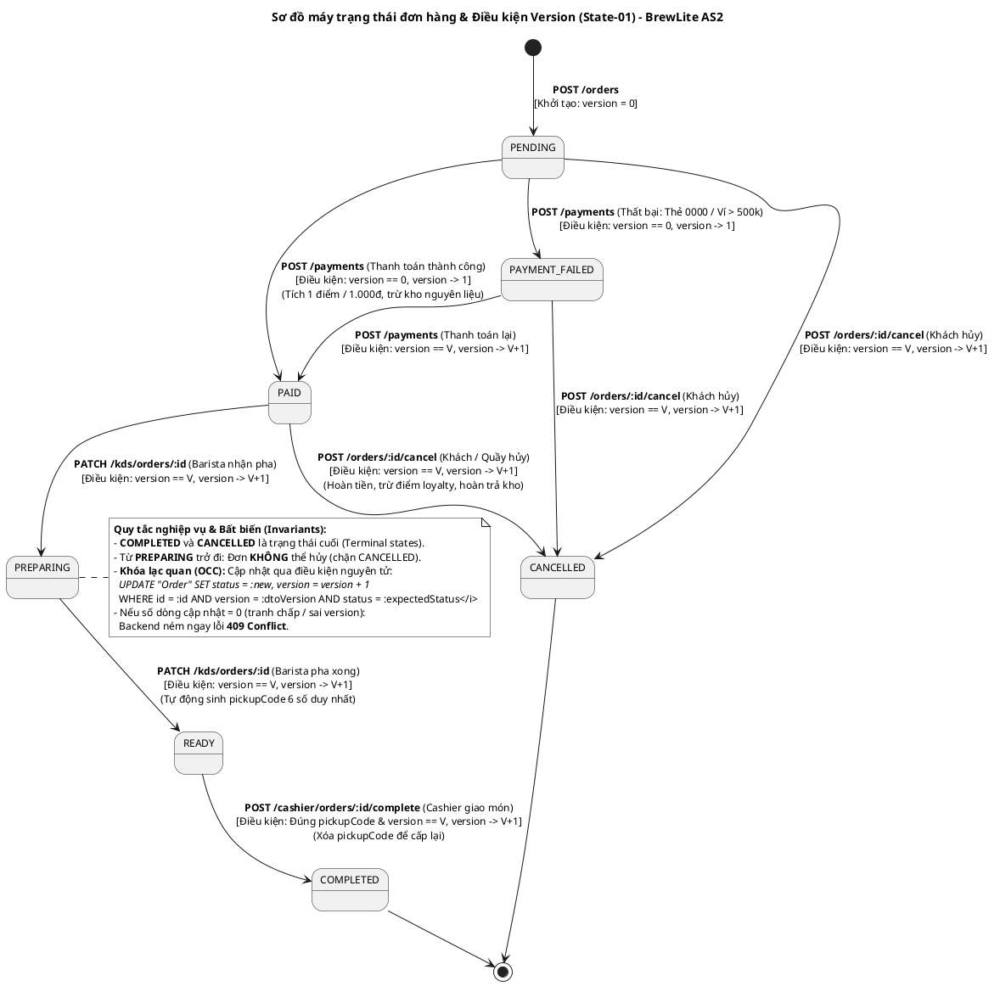
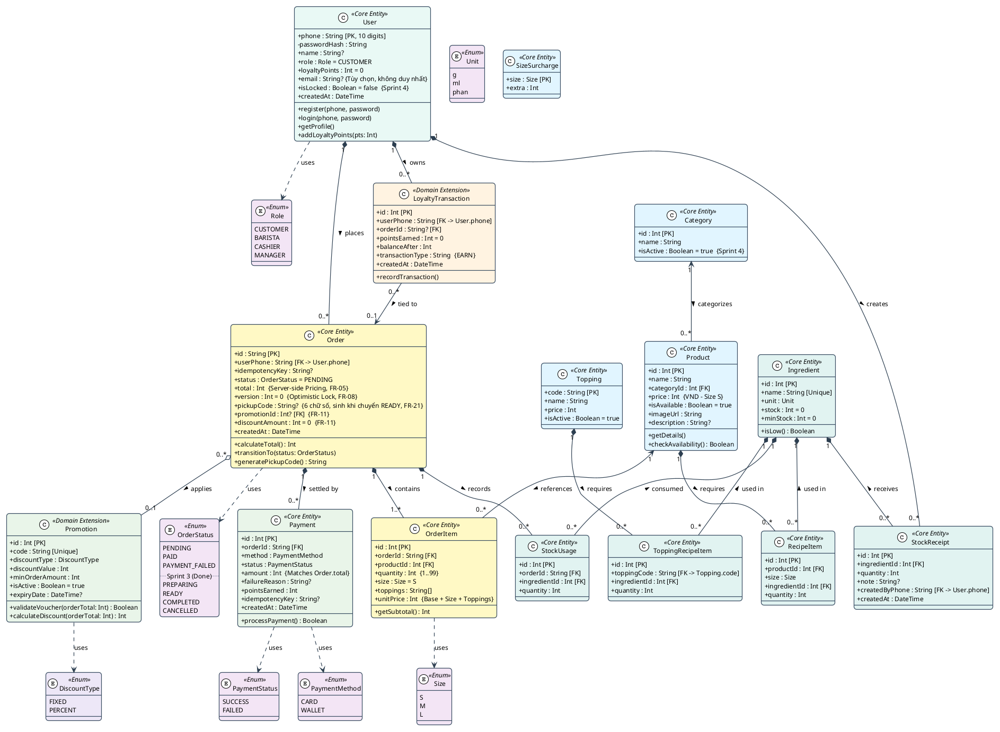
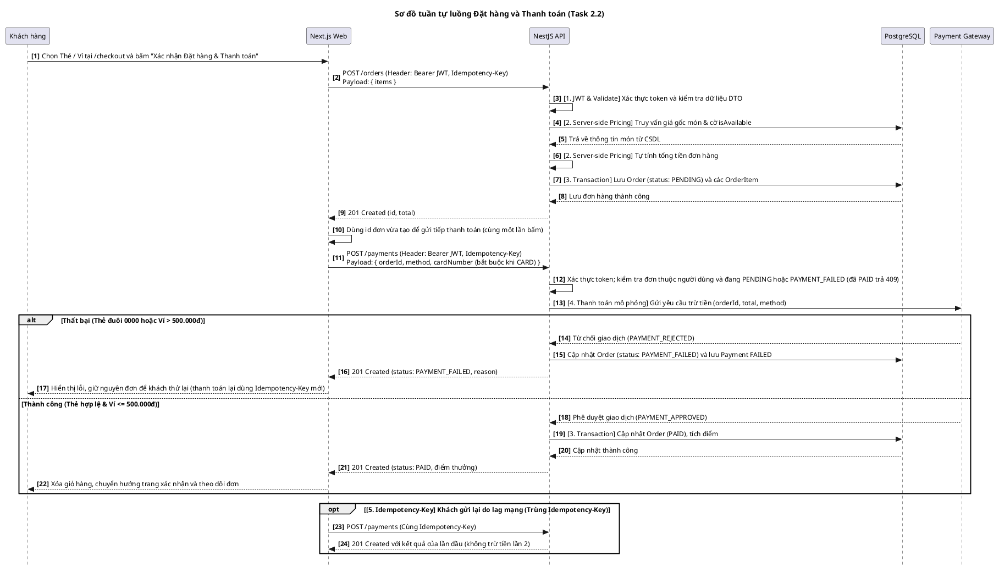
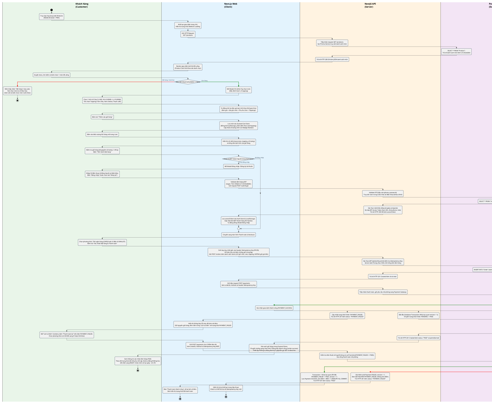
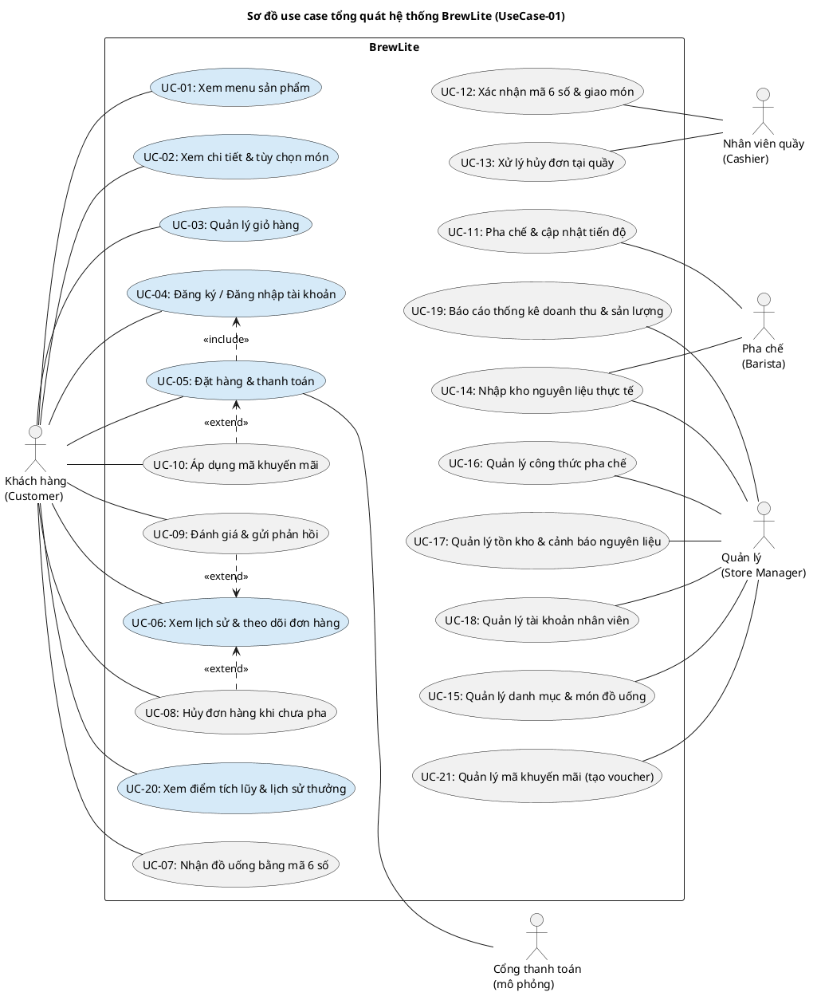
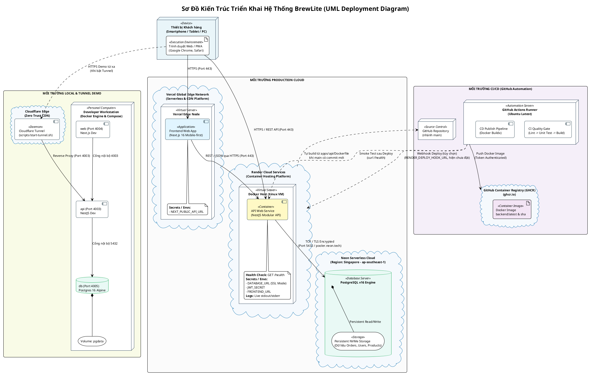

# HỆ THỐNG SƠ ĐỒ THIẾT KẾ KIẾN TRÚC & PHÂN TÍCH (BREWLITE AS2)

> **Dự án:** BrewLite - Hệ thống Đặt cà phê không dùng tiền mặt (Assignment 2)  
> **Chuẩn mô hình hóa:** PlantUML & UML 2.5 standard  
> **Quy ước nguồn sự thật:** File `.puml` là mã nguồn sự thật, xuất tự động ra `.svg` (vector) và `.png` (raster).

---

## 📑 PHẦN I: SƠ ĐỒ KIẾN TRÚC & LUỒNG NGHIỆP VỤ TỔNG THỂ

| Mã Sơ Đồ | Tên Sơ Đồ | Loại Sơ Đồ | Phân Hệ Nghiệp Vụ | Nguồn PlantUML | Bản Vẽ Vector | Hình Ảnh Minh Họa | Đặc Tả Chi Tiết |
|:---:|---|:---:|---|:---:|:---:|:---:|:---:|
| **STATE-01**| Máy Trạng Thái Đơn Hàng & Khóa Lạc Quan | State Machine | Orders, Payments, KDS, Cashier | [orders-state.puml](./orders-state.puml) | [SVG](./orders-state.svg) | [PNG](./orders-state.png) | [Đặc tả State Machine](./orders-state.md) |
| **CLASS-01**| Miền Dữ Liệu & Thực Thể (Domain Model) | Class / ERD | CSDL PostgreSQL & Domain | [class-domain.puml](./class-domain.puml) | [SVG](./class-domain.svg) | [PNG](./class-domain.png) | [Đặc tả Domain Model](./class-domain.md) |
| **SEQ-01**| Tuần Tự Xử Lý Đặt Hàng & Thanh Toán | Sequence | Orders, Pricing, Payments | [sequence-checkout.puml](./sequence-checkout.puml) | [SVG](./sequence-checkout.svg) | [PNG](./sequence-checkout.png) | [Đặc tả Sequence](./sequence-checkout.md) |
| **ACT-01**| Hoạt Động Menu, Giỏ Hàng & Auth | Activity | Menu, Cart, Authentication | [activity-01-menu-cart-auth.puml](./activity-01-menu-cart-auth.puml) | [SVG](./activity-01-menu-cart-auth.svg) | [PNG](./activity-01-menu-cart-auth.png) | [Đặc tả Activity](./activity-01-menu-cart-auth.md) |
| **UC-01** | Use-case Tổng Quan Hệ Thống | Use Case | Toàn hệ thống (4 Actors) | [usecase-overview.puml](./usecase-overview.puml) | [SVG](./usecase-overview.svg) | [PNG](./usecase-overview.png) | [Tài liệu Use-cases](../requirements/use-case-overview.md) |
| **UC-02** | Use-case Đặt Hàng & Thanh Toán | Use Case | Customer, Order, Payment | [usecase-checkout.puml](./usecase-checkout.puml) | [SVG](./usecase-checkout.svg) | [PNG](./usecase-checkout.png) | [Tài liệu Checkout](../requirements/use-case-checkout.md) |
| **DEP-01**| Kiến Trúc Triển Khai Hạ Tầng | Deployment | Vercel, Render, Neon, Docker | [deployment.puml](./deployment.puml) | [SVG](./deployment.svg) | [PNG](./deployment.png) | [Đặc tả Triển Khai](./deployment.md) |

---

### 1. Sơ Đồ Máy Trạng Thái Đơn Hàng & Khóa Lạc Quan (State-01)
Mô tả vòng đời khép kín từ lúc khách tạo đơn, thanh toán, pha chế trên KDS đến khi hoàn tất giao hàng tại quầy hoặc hủy, kết hợp cơ chế kiểm soát tranh chấp bằng khóa lạc quan (OCC - Optimistic Concurrency Control qua trường `version`):

---

### 2. Sơ Đồ Miền Dữ Liệu & Thực Thể Toàn Hệ Thống (Class-01)
Mô hình hóa toàn bộ cấu trúc dữ liệu quan hệ (ERD/Domain): Users, Products, Categories, Orders, OrderItems, Payments, Vouchers, Inventory, Recipes (BOM), Reviews:

---

### 3. Sơ Đồ Tuần Tự Luồng Đặt Hàng & Thanh Toán (Sequence-01)
Minh họa luồng gọi API từ Web Client $\rightarrow$ NestJS Controller $\rightarrow$ Service $\rightarrow$ Prisma Transaction, xác thực JWT, tính giá server-side, kiểm tra Idempotency và cổng thanh toán:

---

### 4. Sơ Đồ Hoạt Động Luồng Chọn Món & Đăng Nhập (Activity-01)
Quy trình từ lúc khách duyệt thực đơn, chọn size, topping, kiểm tra trạng thái đăng nhập đến khi chuyển sang giỏ hàng:

---

### 5. Sơ Đồ Use-Case Tổng Quan Hệ Thống (UC-01)
Phân quyền tương tác của 4 tác nhân chính: Khách hàng (Customer), Nhân viên pha chế (Barista), Thu ngân (Cashier), và Quản lý cửa hàng (Manager):

---

### 6. Sơ Đồ Kiến Trúc Triển Khai Hạ Tầng (Deployment-01)
Kiến trúc Micro-Cloud kết hợp Vercel Edge (Frontend), Render Container (Backend NestJS), Neon Serverless PostgreSQL (Database) và Docker Compose môi trường Local:

---

## 📑 PHẦN II: SƠ ĐỒ CHI TIẾT THEO TỪNG PHÂN HỆ NGHIỆP VỤ

Mỗi phân hệ đều được đóng gói đầy đủ mã nguồn PlantUML (`.puml`), bản vẽ vector (`.svg`) và hình ảnh raster (`.png`) nằm tại thư mục `docs/diagrams/modules/`:

| Phân Hệ | Thư Mục | Sơ Đồ Hoạt Động (Activity) | Sơ Đồ Tuần Tự (Sequence) | Ghi Chú Kỹ Thuật |
|---|:---:|:---:|:---:|---|
| 🧑‍🍳 **Màn Hình Bếp (KDS)** | [`modules/kds/`](./modules/kds/) | [Xem ảnh](./modules/kds/kds-activity.png) | [Xem ảnh](./modules/kds/kds-sequence.png) | Barista nhận đơn $\rightarrow$ `PREPARING` $\rightarrow$ pha xong $\rightarrow$ `READY` & sinh mã `pickupCode` |
| ❌ **Hủy Đơn Hàng (Cancel)** | [`modules/cancel/`](./modules/cancel/) | [Xem ảnh](./modules/cancel/cancel-activity.png) | [Xem ảnh](./modules/cancel/cancel-sequence.png) | Hủy đơn kèm điều kiện OCC version, hoàn tiền & hoàn trả kho nguyên liệu |
| 💳 **Thanh Toán (Payments)** | [`modules/payments/`](./modules/payments/) | [Xem ảnh](./modules/payments/payments-activity.png) | [Xem ảnh](./modules/payments/payments-sequence.png) | Xử lý Thẻ (từ chối 0000) / Ví điện tử, `Idempotency-Key`, tích điểm loyalty |
| 📦 **Đặt Đơn (Orders)** | [`modules/orders/`](./modules/orders/) | [Xem ảnh](./modules/orders/orders-activity.png) | [Xem ảnh](./modules/orders/orders-sequence.png) | Tính giá server-side, áp voucher, khởi tạo đơn `PENDING` (version=0) |
| ☕ **Menu & Món (Products)** | [`modules/products/`](./modules/products/) | [Xem ảnh](./modules/products/products-activity.png) | [Xem ảnh](./modules/products/products-sequence.png) | Danh mục món, tùy biến Size (S/M/L) và Toppings |
| 🔐 **Đăng Ký (Register)** | [`modules/register/`](./modules/register/) | [Xem ảnh](./modules/register/register-activity.png) | [Xem ảnh](./modules/register/register-sequence.png) | Đăng ký số điện thoại di động VN, băm mật khẩu `bcryptjs` |
| 🔑 **Đăng Nhập (Login)** | [`modules/login/`](./modules/login/) | [Xem ảnh](./modules/login/login-activity.png) | [Xem ảnh](./modules/login/login-sequence.png) | Cấp phát JWT Access Token và phân quyền 5 nhóm vai trò RBAC |
| 🗄️ **CSDL Chi Tiết (Database)** | [`modules/database/`](./modules/database/) | — | [Xem ERD](./modules/database/database-erd.png) | Sơ đồ quan hệ thực thể cơ sở dữ liệu chi tiết |
