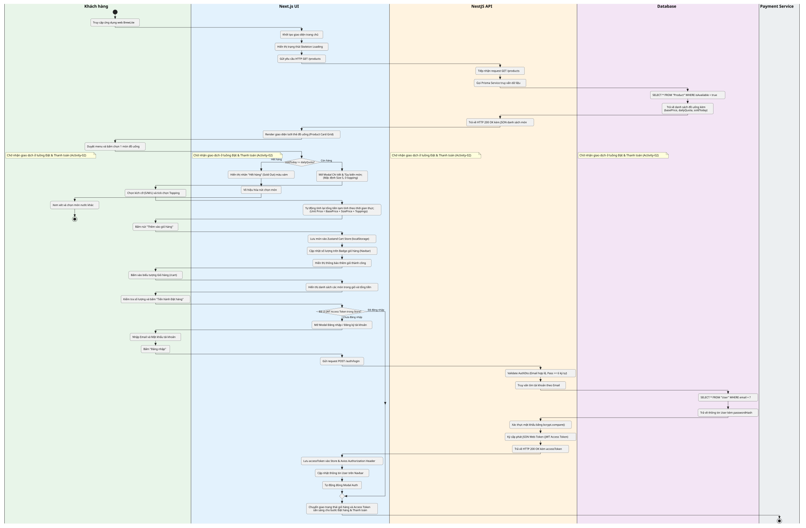

# Bản Đặc Tả Luồng Hoạt Động End-to-End — Activity-01 (Task 2.1)

> **Dự án:** Ứng dụng đặt cà phê không tiền mặt BrewLite  
> **Môn học:** Công nghệ phần mềm — Học kỳ 1, Năm học 2026–2027  
> **Mã sơ đồ:** `Activity-01` | **Mã Issue:** `[D2.1a] #39` (Phụ trách Issue Backlog `#03` — Task 2.1)  
> **Người thực hiện:** **Trần Quốc Tài (`TaiTran263`)**  
> **Người duyệt:** **Nguyễn Thành Long (`Longcodepro`)**  
> **Tài liệu đối chiếu và tham chiếu:**
> - `docs/diagrams/usecase-overview.puml` (Sơ đồ Use Case tổng quát `UseCase-01` — Issue #37 `[D1.2d]`)
> - `docs/requirements/context-and-scope.md` (Bối cảnh, Stakeholder, Mục 1.4 Luồng khách End-to-End — Issue #33)
> - `docs/requirements/requirements-web.md` (`FR-01`, `FR-02`, `FR-03`, `FR-07`, `NFR-01`, `NFR-03`)
> - `docs/requirements/requirements-api.md` (`FR-04`, `FR-05`, `FR-06`, `FR-08`, `FR-09`, `FR-10`)
> - `docs/architecture/api-contract.md` (`GET /products`, `POST /auth/login`, `POST /auth/register`, `POST /orders`, `POST /payments`)

---

## 1. Mục Tiêu & Sự Tương Thích Với Sơ Đồ Use Case

Sơ đồ **`Activity-01`** mô hình hóa luồng nghiệp vụ **End-to-End MVP (Sprint 1-2)** của khách hàng trong hệ thống BrewLite, từ duyệt thực đơn đến thanh toán. Sơ đồ hiện thực hóa trực tiếp các Use Case thuộc phân hệ Khách hàng trên sơ đồ Use Case tổng quát (`UseCase-01`):

1. **`UC-01: Xem menu sản phẩm`**: Tải thực đơn từ máy chủ, hiển thị lưới thẻ sản phẩm trên giao diện di động (*Mobile-First*), hỗ trợ trạng thái chờ tải và phát hiện món hết hàng theo cờ `isAvailable`.
2. **`UC-02: Xem chi tiết & tùy chọn món`**: Mở Modal chi tiết cho phép khách chọn 1 trong 3 kích cỡ (S/M/L, phụ thu cố định) và tick chọn nhiều topping. Tính toán lại đơn giá thời gian thực.
3. **`UC-03: Quản lý giỏ hàng`**: Quản lý giỏ hàng phía Client bằng Zustand Store (đồng bộ `localStorage`), hỗ trợ tăng/giảm số lượng (1 đến 99 ly/dòng) và xóa món.
4. **`UC-04: Đăng ký / Đăng nhập tài khoản`**: Khách hàng đăng ký hoặc đăng nhập bằng **số điện thoại di động Việt Nam hợp lệ** và mật khẩu, nhận `JWT Access Token` (hạn 24 giờ, chứa `phone` và `role`).
5. **`UC-05: Đặt hàng & thanh toán`**:
   - Đính kèm header **`Idempotency-Key`** (chống trừ tiền lặp lại do mạng lag — `FR-09`).
   - Server-side Pricing độc quyền tại backend (chống gian lận giá client — `FR-05`).
   - Thanh toán mô phỏng qua 2 kênh: Thẻ ngân hàng (`CARD`), Ví điện tử (`WALLET`).
   - Xử lý hai nhánh:
     - **Thanh toán thất bại** (thẻ 4 số cuối `0000`, hoặc ví với đơn trên 500.000đ): đơn chuyển `PAYMENT_FAILED`, trả `HTTP 201` kèm `status: "PAYMENT_FAILED"`, giữ nguyên giỏ hàng để khách thử lại.
     - **Thanh toán thành công**: đơn chuyển `PAID`, cộng điểm thưởng (`FR-10`), xóa giỏ hàng.
6. **Tiếp nối `UC-06`**: Chuyển sang màn hình theo dõi trạng thái đơn hàng bằng polling 5 giây/lần (`GET /orders/me`).

> **Ghi chú phạm vi:** Mã nhận hàng 6 số (`pickupCode`, `UC-07`) và màn hình pha chế KDS thuộc **Sprint 3 (Planned)**, chỉ sinh khi đơn chuyển `READY` — không nằm trong luồng MVP Sprint 1-2 này.

---

## 2. Quy Ước 5 Làn Bơi (Swimlanes) Phân Định Trách Nhiệm

| STT | Swimlane | Đối tượng đại diện | Vai trò và nhiệm vụ cốt lõi trong luồng |
|:---:|---|---|---|
| **1** | **Khách hàng (Customer)** | Tác nhân chính (Actor) | Truy cập ứng dụng, chọn món, tùy biến size/topping, quản lý giỏ hàng, xác thực tài khoản SĐT, chọn phương thức thanh toán. |
| **2** | **Next.js Web (Client)** | Phân hệ giao diện Web | Render Skeleton loading, quản lý Modal tùy chọn, tính giá tạm tính, quản lý Zustand Store (`localStorage`), sinh `Idempotency-Key`, điều hướng giao diện, polling trạng thái đơn. |
| **3** | **NestJS API (Server)** | Máy chủ Backend | Tiếp nhận HTTP Request, xác thực JWT Guard, tính toán lại giá độc quyền (Server-side Pricing), điều phối Database Transaction và gọi Payment Gateway. |
| **4** | **PostgreSQL (Database)** | Cơ sở dữ liệu quan hệ | Truy vấn thực đơn (`Product`), xác thực người dùng theo `phone` (`User`), lưu bản ghi `Order`, `OrderItem` và `Payment`. |
| **5** | **Cổng thanh toán (Payment Gateway)** | Hệ thống bên ngoài (Mô phỏng) | Tiếp nhận yêu cầu thanh toán mô phỏng, phản hồi kết quả thành công (`PAYMENT_SUCCESS`) hoặc thất bại (`PAYMENT_FAILED`). |

---

## 3. Diễn Giải Chi Tiết 6 Giai Đoạn Luồng Nghiệp Vụ

### Giai đoạn 1: UC-01 — Xem menu sản phẩm (FR-01)
1. Khách hàng truy cập ứng dụng web BrewLite trên trình duyệt di động hoặc máy tính.
2. `Next.js Web` khởi tạo trang chủ, hiển thị hiệu ứng khung xương nhấp nháy (*Skeleton Loading State*).
3. `Next.js Web` gửi yêu cầu HTTP `GET /products` sang backend.
4. `NestJS API` tiếp nhận request, gọi `PrismaService` truy vấn dữ liệu từ bảng `Product`.
5. `PostgreSQL` trả về danh sách đồ uống kèm cờ `isAvailable`.
6. `NestJS API` phản hồi `HTTP 200 OK` kèm JSON danh sách món.
7. `Next.js Web` render danh sách thành lưới các thẻ sản phẩm (*Product Card Grid* phân theo tab danh mục).
8. Khách hàng duyệt menu và chọn 1 món đồ uống:
   - **Nhánh hết hàng:** Nếu `isAvailable == false`, giao diện hiển thị nhãn xám "Hết hàng" (Sold Out) và vô hiệu hóa nút bấm. Khách hàng chọn món khác.
   - **Nhánh còn hàng:** Tiếp tục mở Modal chi tiết món (`UC-02`).

### Giai đoạn 2: UC-02 — Xem chi tiết & tùy chọn món (FR-02)
9. `Next.js Web` mở Modal Chi tiết & Tùy chọn món (mặc định Size S, 0 topping).
10. Khách hàng chọn 1 trong 3 kích cỡ: **Size S** (+0đ), **Size M** (+5.000đ), **Size L** (+10.000đ); tick chọn 0, 1 hoặc nhiều Topping (Trân châu đen +8.000đ, Kem cheese +10.000đ, Thạch cà phê +6.000đ).
11. `Next.js Web` tự động tính toán lại đơn giá ly nước theo thời gian thực: `Đơn giá = Giá gốc món + Phụ thu Size + Σ giá Topping`.

### Giai đoạn 3: UC-03 — Quản lý giỏ hàng (FR-03)
12. Khách hàng bấm nút **"Thêm vào giỏ hàng"**.
13. `Next.js Web` lưu món vào Zustand Cart Store (đồng bộ `localStorage`), phân tách riêng các dòng khác size/topping. Khống chế tối đa 99 ly trên mỗi dòng món.
14. Badge đếm tổng số ly trên Navbar tự động cập nhật.
15. Khách hàng bấm biểu tượng Giỏ hàng trên thanh điều hướng để mở trang `/cart`.
16. `Next.js Web` hiển thị chi tiết từng dòng món trong giỏ, số lượng, tùy chọn và tổng tiền tạm tính.
17. Khách hàng tăng/giảm số lượng nếu cần, rồi bấm **"Tiến hành Đặt hàng"**.

### Giai đoạn 4: UC-04 — Đăng ký / Đăng nhập tài khoản (UC-05 `<<include>>` UC-04, FR-04)
18. `Next.js Web` kiểm tra trạng thái xác thực trong Zustand Auth Store:
    - **Nếu đã có JWT Token hợp lệ:** Bỏ qua bước đăng nhập, chuyển thẳng sang màn hình Thanh toán.
    - **Nếu chưa đăng nhập:**
      - `Next.js Web` mở Modal Đăng nhập / Đăng ký tài khoản.
      - Khách hàng nhập **số điện thoại di động Việt Nam hợp lệ** (đầu số `0`/`+84`, tiếp theo `3`/`5`/`7`/`8`/`9`) và **Mật khẩu**; bấm "Đăng nhập" (hoặc chuyển tab "Đăng ký").
      - `Next.js Web` gửi request `POST /auth/login` (hoặc `POST /auth/register`).
      - `NestJS API` kiểm tra hợp lệ DTO, truy vấn `User` trong `PostgreSQL` theo `phone` (khóa chính).
      - `NestJS API` xác thực mật khẩu qua `bcryptjs.compare()`, ký cấp `JWT Access Token` (hạn 24 giờ, chứa `phone` và `role`).
      - `NestJS API` phản hồi `HTTP 200 OK` kèm `accessToken`.
      - `Next.js Web` lưu `accessToken` vào Auth Store & `localStorage`, cập nhật thông tin tài khoản trên Navbar và tự động đóng Modal.

### Giai đoạn 5: UC-05 — Đặt hàng & thanh toán (FR-05, FR-06, FR-08, FR-09)
19. `Next.js Web` chuyển sang màn hình Thanh toán (`/checkout`).
20. Khách hàng chọn 1 trong 2 phương thức thanh toán mô phỏng: **Thẻ ngân hàng (`CARD`)** hoặc **Ví điện tử (`WALLET`)**, rồi bấm nút **"Xác nhận Đặt hàng & Thanh toán"**.
21. `Next.js Web` sinh key duy nhất đính kèm header **`Idempotency-Key`**, gửi `POST /orders` kèm danh sách món (`productId`, `size`, `toppings`, `quantity`) — **tuyệt đối không gửi giá tiền**.
22. `NestJS API` xác thực JWT qua `JwtAuthGuard`, kiểm tra `Idempotency-Key`, thực hiện **Server-side Pricing** (đọc giá gốc từ CSDL để tự tính tổng tiền), tạo bản ghi `Order` trạng thái `PENDING`, `version = 0`, trả về `HTTP 201 Created` kèm `id` và `total`.
23. `Next.js Web` gửi tiếp `POST /payments` kèm `orderId`, `method` (và `cardNumber` nếu `CARD`) cùng header `Idempotency-Key` mới.
24. `NestJS API` chuyển tiếp yêu cầu sang Cổng thanh toán mô phỏng, xử lý theo quy tắc mô phỏng:
    - **Nhánh Thanh toán Thất bại** *(thẻ có 4 số cuối là `0000`, hoặc ví với đơn trên 500.000đ)*:
      - Cổng thanh toán trả về `PAYMENT_FAILED`.
      - `NestJS API` cập nhật `Order` sang trạng thái `PAYMENT_FAILED`, lưu bản ghi `Payment` trạng thái `FAILED`; trả về `HTTP 201 Created` kèm `status: "PAYMENT_FAILED"` (không phải lỗi HTTP, vì hệ thống đã ghi nhận một lần thanh toán).
      - `Next.js Web` hiển thị cảnh báo lỗi thanh toán màu đỏ; **giữ nguyên toàn bộ giỏ hàng và đơn hàng**.
      - Khách hàng đổi phương thức thanh toán khác hoặc bấm thanh toán lại (dùng `Idempotency-Key` mới).
    - **Nhánh Thanh toán Thành công** *(thẻ hợp lệ, hoặc ví với đơn không quá 500.000đ)*:
      - Cổng thanh toán trả về `PAYMENT_SUCCESS`.
      - `NestJS API` mở Database Transaction: cập nhật `Order` sang `PAID` (khóa lạc quan, `version` tăng thêm 1 — `FR-08`), lưu bản ghi `Payment` trạng thái `SUCCESS`, cộng điểm thưởng 1 điểm/1.000đ thực trả vào `User` (`FR-10`), rồi `COMMIT`.
      - `NestJS API` phản hồi `HTTP 201 Created` kèm `status: "PAID"` và `pointsEarned`.
      - `Next.js Web` xóa sạch giỏ hàng trong Zustand Store, chuyển hướng sang màn hình Thông báo thành công (`/order-success`).

### Giai đoạn 6: UC-06 — Theo dõi đơn hàng (FR-07)
25. `Next.js Web` thiết lập cơ chế Polling tự động định kỳ 5 giây/lần gọi `GET /orders/me` để cập nhật trạng thái đơn. Khách hàng xem trạng thái đơn `PAID` và tiến độ cập nhật tự động. *(Khi đơn chuyển `READY` ở Sprint 3 Planned, khách hàng mới nhận mã 6 số tại quầy — `UC-07`, ngoài phạm vi luồng MVP này.)* Kết thúc luồng (`stop`).

---

## 4. Bảng Phân Tích Các Điểm Rẽ Nhánh Điều Kiện (Decision Nodes)

| STT | Nút rẽ nhánh (Decision Node) | Điều kiện kiểm tra | Nhánh xử lý | Kết quả thực thi hệ thống |
|:---:|---|---|---|---|
| **1** | **Tình trạng món đồ uống** *(Tại UC-01 Menu)* | `isAvailable == false` | **Hết hàng** | Hiển thị nhãn xám "Hết hàng", vô hiệu hóa chọn món. Khách chọn món khác. |
| | | `isAvailable == true` | **Còn hàng** | Cho phép bấm chọn, mở Modal tùy biến size và topping (`UC-02`). |
| **2** | **Trạng thái phiên xác thực** *(Tại UC-04 Auth)* | Chưa có JWT hợp lệ | **Chưa đăng nhập** | Mở Modal Auth, yêu cầu nhập SĐT + Mật khẩu, xác thực bcrypt, cấp JWT mới được đặt hàng. |
| | | Đã có JWT hợp lệ | **Đã đăng nhập** | Bỏ qua bước xác thực, chuyển thẳng sang màn hình Thanh toán (`UC-05`). |
| **3** | **Kết quả thanh toán mô phỏng** *(Tại UC-05 Payment)* | Thẻ đuôi `0000`, hoặc ví với đơn trên 500.000đ | **Thanh toán thất bại** | Đơn chuyển `PAYMENT_FAILED`, **không cộng điểm**, giữ nguyên giỏ hàng và đơn để khách đổi phương thức/thử lại. |
| | | Thẻ hợp lệ, hoặc ví với đơn không quá 500.000đ | **Thanh toán thành công** | Đơn chuyển `PAID`, cộng điểm thưởng, xóa giỏ hàng, chuyển màn hình thành công. |

---

## 5. Các Cơ Chế Kỹ Thuật & Bảo Vệ Cốt Lõi Được Tích Hợp

1. **Khóa chống gửi trùng (`Idempotency-Key`, FR-09):**
   - Client sinh key duy nhất cho mỗi lần bấm "Đặt hàng"/"Thanh toán", đính kèm qua HTTP Header `Idempotency-Key`.
   - Nếu mạng lag hoặc khách bấm nhiều lần, Backend kiểm tra key và chỉ xử lý đúng 1 lần duy nhất.
2. **Định giá độc quyền phía máy chủ (Server-side Pricing, FR-05):**
   - Frontend chỉ gửi mã món (`productId`), `size`, và mảng mã topping (`toppings`).
   - Backend truy vấn trực tiếp bảng giá trong PostgreSQL để tính tổng tiền; loại bỏ mọi trường giá từ client.
3. **Khóa lạc quan (Optimistic Locking, FR-08):**
   - Cột `version` trên `Order` chống ghi đè trạng thái đồng thời; cập nhật sai `version` trả lỗi `409 Conflict`.
4. **Database Transaction (ACID):**
   - Khi thanh toán thành công: cập nhật `Order` → `PAID`, lưu `Payment`, cộng điểm thưởng đều nằm trong cùng một transaction, đảm bảo không có trạng thái nửa vời.

---

## 6. Sơ Đồ Hoạt Động Trực Quan (Activity Diagram)

Sơ đồ chi tiết bằng PlantUML đã được đồng bộ hóa với sơ đồ Use Case tổng quan và `requirements-api.md`:

* **Tệp mã nguồn PlantUML:** [`activity-01-menu-cart-auth.puml`](./activity-01-menu-cart-auth.puml)
* **Tệp ảnh vector SVG:** [`activity-01-menu-cart-auth.svg`](./activity-01-menu-cart-auth.svg)
