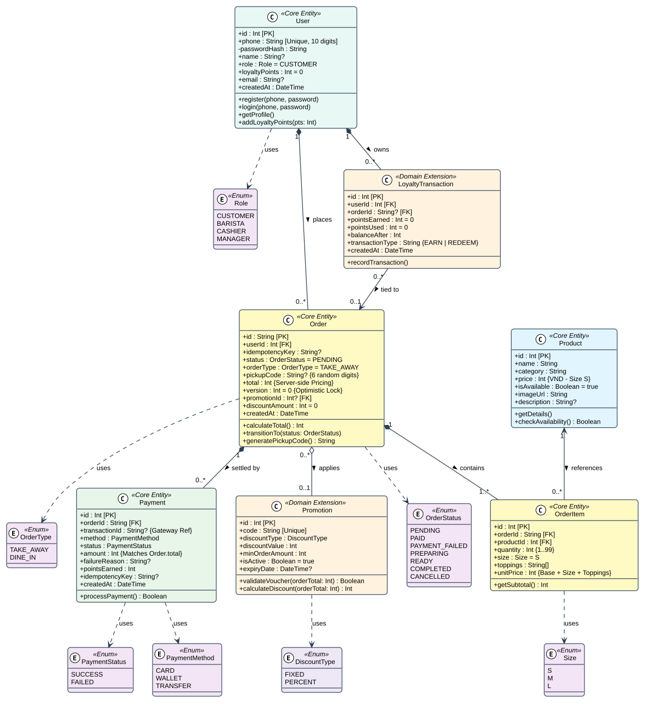

# Đặc Tả Sơ Đồ Lớp Miền Nghiệp Vụ — Class Domain (Issue D2.3)

> **Mã sơ đồ:** `Class-01` | **Mã Issue:** `[D2.3]`  
> **Người thực hiện:** **Trần Quốc Tài (`TaiTran263`)**  
> **Tài liệu tham chiếu:** `apps/api/prisma/schema.prisma` và `docs/requirements/requirements.md`

---

## 1. Danh Sách 7 Lớp Thực Thể (Entities)

### A. Nhóm 5 Lớp Cốt Lõi (Đã có bảng CSDL):
1. **`User`**: Khách hàng (email, passwordHash, loyaltyPoints).
2. **`Product`**: Món đồ uống trong menu (name, price niêm yết Size S, imageUrl).
3. **`Order`**: Đơn hàng tổng thể (idempotencyKey, status, total, version - khóa lạc quan).
4. **`OrderItem`**: Chi tiết ly nước trong đơn (size S/M/L, toppings, số lượng, unitPrice).
5. **`Payment`**: Giao dịch thanh toán (method CARD/WALLET, status SUCCESS/FAILED, failureReason, pointsEarned).

### B. Nhóm 2 Lớp Mở Rộng (Domain Extension):
6. **`Promotion`**: Quản lý mã giảm giá (voucher). *Lưu ý: Chưa tạo bảng trong schema.prisma.*
7. **`LoyaltyTransaction`**: Lịch sử chi tiết cộng/trừ điểm thưởng. *Lưu ý: Hiện tại CSDL lưu trực tiếp cột `loyaltyPoints` trong bảng User và `pointsEarned` trong Payment.*

---

## 2. Sơ Đồ Lớp Trực Quan

* **Tệp nguồn PlantUML:** [`class-domain.puml`](./class-domain.puml)
* **Tệp ảnh vector SVG:** [`class-domain.svg`](./class-domain.svg)