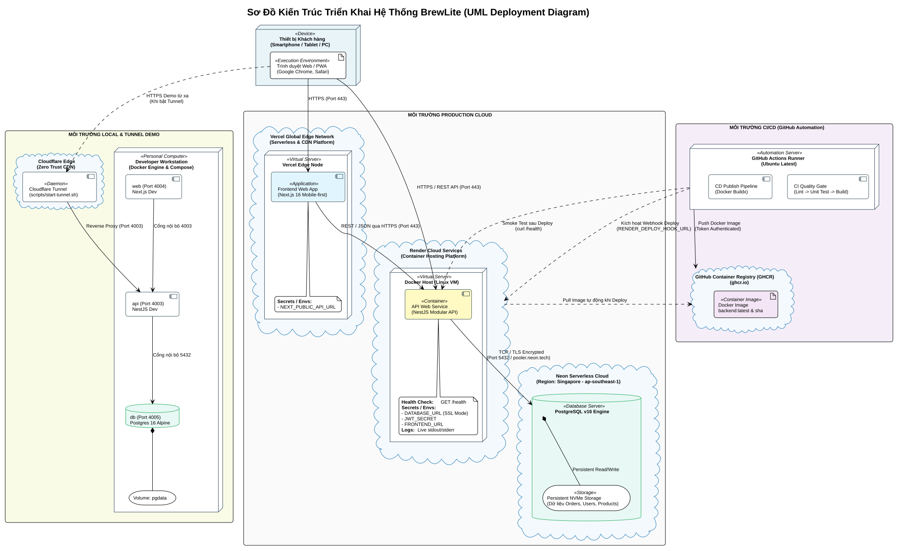

# Đặc Tả Kiến Trúc Triển Khai Hệ Thống — Deployment (Issue D3.2a)

> **Mã sơ đồ:** `Deployment-01` | **Mã Issue:** `[D3.2a] #44`  
> **Người thực hiện:** **Trần Quốc Tài (`TaiTran263`)**  
> **Tài liệu tham chiếu:** `docs/deployment.md`, `docker-compose.yml`, `.github/workflows/cd.yml`

---

## 1. Phân Tích Các Ranh Giới Hạ Tầng (Environment Boundaries)

### 1.1. Môi trường Production Cloud (Vận hành thực tế):
* **Frontend (Vercel):** Phục vụ ứng dụng Next.js Mobile-first qua mạng lưới máy chủ biên Edge CDN với chứng chỉ bảo mật HTTPS (Port 443).
* **Backend API (Render Cloud):** Container NestJS build từ `apps/api/Dockerfile`, Render kết nối GitHub và tự deploy khi `main` có commit mới, tự động cấu hình biến môi trường bí mật (`DATABASE_URL`, `JWT_SECRET`), có endpoint `GET /health` và theo dõi log luồng thời gian thực.
* **Database (Neon Serverless PostgreSQL):** Đặt tại khu vực Singapore (`ap-southeast-1`), lưu trữ dữ liệu vĩnh viễn trên ổ cứng NVMe chuyên dụng, giao tiếp bảo mật qua đường truyền TLS mã hóa (Port 5432).

### 1.2. Môi trường Tự động hóa CI/CD (GitHub Actions):
* **CI Quality Gate:** Kiểm tra toàn diện linting, unit test và build độc lập cho cả `apps/web` và `apps/api`.
* **CD Pipeline:** Tự động build Docker Image và đẩy lên GitHub Container Registry (`ghcr.io`), Webhook triển khai Render và Smoke Test chỉ chạy khi đã cấu hình secret (hiện chưa đặt nên được bỏ qua).

### 1.3. Môi trường Local & Demo (Docker Compose & Tunnel):
* Chạy trọn vẹn 3 service (`web:4004`, `api:4003`, `db:4005`) qua một lệnh `docker compose up`.
* Hỗ trợ Cloudflare Tunnel (`scripts/start-tunnel.sh`) để phát đường dẫn HTTPS tức thì cho phép thầy cô và bạn bè chấm bài trên điện thoại thật.

---

## 2. Sơ Đồ Triển Khai Trực Quan (Deployment Diagram)

* **Tệp nguồn PlantUML:** [`deployment.puml`](./deployment.puml)
* **Tệp ảnh vector SVG:** [`deployment.svg`](./deployment.svg)