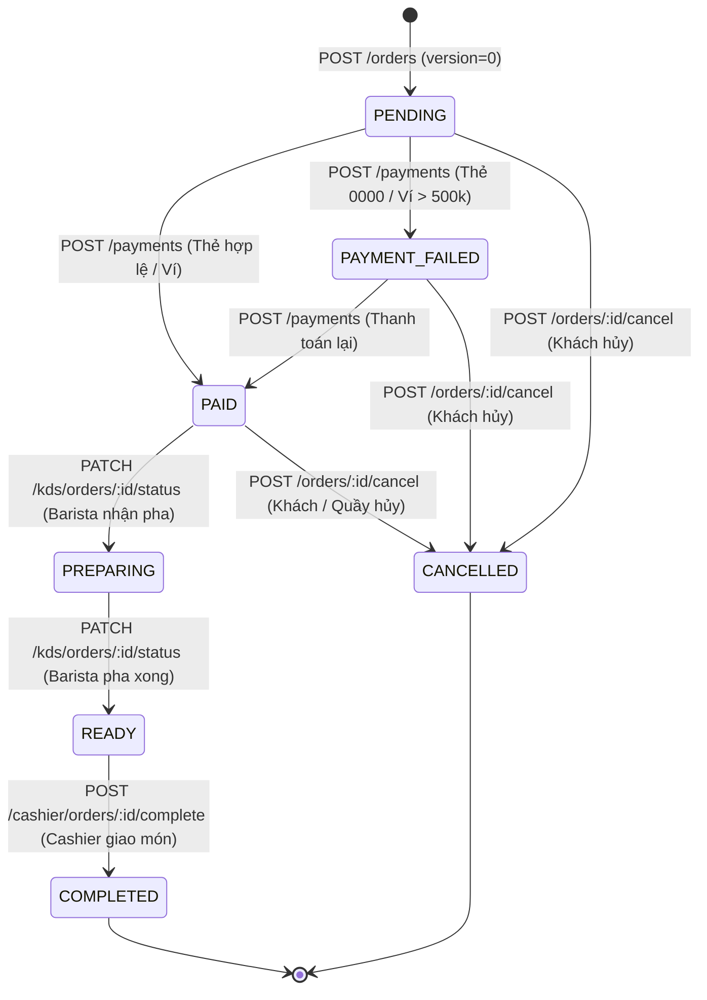

# ĐẶC TẢ MÁY TRẠNG THÁI ĐƠN HÀNG (ORDER FINITE STATE MACHINE & OCC)

> **Mã sơ đồ:** `State-01`  
> **Phân hệ:** Orders, Payments, KDS (Barista), Cashier, Inventory  
> **Yêu cầu liên quan:** FR-05, FR-06, FR-09, FR-11, NFR-05, UC-05, UC-06, UC-07, UC-08, UC-11, UC-12  
> **Nguồn sự thật:** `docs/diagrams/orders-state.puml` · Hình ảnh: `docs/diagrams/orders-state.png` / `docs/diagrams/orders-state.svg`

---

## 1. VÒNG ĐỜI VÀ MÁY TRẠNG THÁI ĐƠN HÀNG

Vòng đời đơn hàng trong BrewLite được thiết kế như một **Finite State Machine (FSM)** nghiêm ngặt. Hệ thống không cho phép nhảy cóc trạng thái hoặc chuyển trạng thái không hợp lệ:



---

## 2. BẢNG MA TRẬN CHUYỂN DỊCH TRẠNG THÁI (STATE TRANSITION MATRIX)

| Trạng thái hiện tại | Sự kiện kích hoạt (Endpoint) | Trạng thái kế tiếp | Điều kiện kiểm tra (Conditions) | Tác vụ đi kèm (Side Effects) |
|---|---|---|---|---|
| `[*] (None)` | `POST /orders` | `PENDING` | Giỏ hàng hợp lệ, tính giá server-side | Khởi tạo đơn với `version = 0` |
| `PENDING` | `POST /payments` | `PAID` | Thẻ khác đuôi `0000`, Ví $\le$ 500k, `version == 0` | Trừ kho nguyên liệu (BOM), cộng điểm loyalty, `version -> 1` |
| `PENDING` | `POST /payments` | `PAYMENT_FAILED` | Thẻ đuôi `0000` hoặc Ví > 500k, `version == 0` | Không trừ kho, không cộng điểm, `version -> 1` |
| `PENDING` | `POST /orders/:id/cancel` | `CANCELLED` | Khách hàng sở hữu đơn, `version == V` | Hoàn trả voucher nếu có, `version -> V+1` |
| `PAYMENT_FAILED`| `POST /payments` | `PAID` | Đổi sang thẻ hợp lệ hoặc ví hợp lệ, `version == V` | Trừ kho nguyên liệu, cộng điểm, `version -> V+1` |
| `PAYMENT_FAILED`| `POST /orders/:id/cancel` | `CANCELLED` | Khách hủy đơn không muốn trả lại, `version == V` | Hoàn trả voucher, `version -> V+1` |
| `PAID` | `PATCH /kds/orders/:id/status`| `PREPARING` | Barista nhận đơn pha, `version == V` | Đơn xuất hiện trạng thái đang pha trên KDS, `version -> V+1` |
| `PAID` | `POST /orders/:id/cancel` | `CANCELLED` | Chưa bắt đầu pha chế, `version == V` | Hoàn tiền, trừ điểm loyalty đã cộng, hoàn trả kho nguyên liệu |
| `PREPARING` | `PATCH /kds/orders/:id/status`| `READY` | Barista hoàn thành pha chế, `version == V` | **Tự động sinh mã nhận hàng nội bộ (`pickupCode`) 6 số**, `version -> V+1` |
| `READY` | `POST /cashier/orders/:id/complete`| `COMPLETED` | Thu ngân nhập đúng `pickupCode`, `version == V` | Hoàn tất giao hàng, thu hồi mã `pickupCode`, `version -> V+1` |

---

## 3. CƠ CHẾ KHÓA LẠC QUAN (OPTIMISTIC CONCURRENCY CONTROL - OCC)

Nhằm giải quyết triệt để bài toán xung đột dữ liệu (Race Conditions, Lost Updates) khi có nhiều nhân viên hoặc khách hàng cùng thao tác trên một đơn hàng cùng một thời điểm (ví dụ: Khách bấm Hủy đơn đúng lúc Barista bấm Nhận pha chế):

1. **Cột `version` (INT):** Mọi bản ghi `Order` đều có cột `version` khởi đầu từ `0`.
2. **Cập nhật nguyên tử (Atomic Update):**
   ```sql
   UPDATE "Order"
   SET status = :nextStatus, version = version + 1, updatedAt = NOW()
   WHERE id = :orderId AND version = :clientVersion AND status = :expectedCurrentStatus;
   ```
3. **Phát hiện tranh chấp:**
   - Nếu câu lệnh `UPDATE` trả về `count = 1`: Cập nhật thành công.
   - Nếu trả về `count = 0`: Chứng tỏ đơn hàng đã bị thay đổi trạng thái bởi một giao dịch khác chạy trước. Backend lập tức từ chối và ném mã lỗi HTTP **`409 Conflict`** kèm thông báo `"Đơn hàng đã được cập nhật bởi thao tác khác. Vui lòng tải lại dữ liệu!"`.
