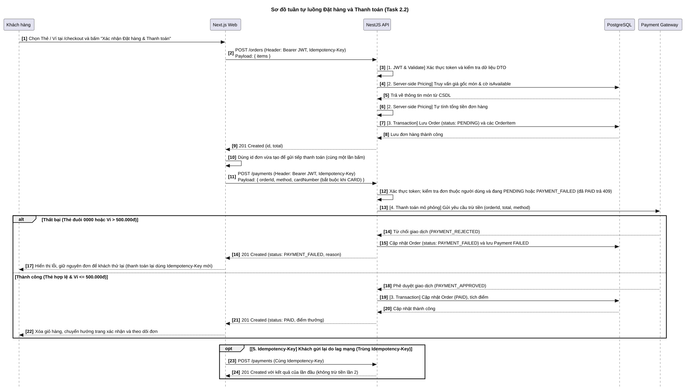

# Đặc Tả Sơ Đồ Tuần Tự Luồng Đặt Hàng & Thanh Toán — Sequence-01 (Task 2.2)

> **Dự án:** Ứng dụng đặt cà phê không tiền mặt BrewLite  
> **Môn học:** Công nghệ phần mềm — Học kỳ 1, Năm học 2026–2027  
> **Mã sơ đồ:** `Sequence-01` | **Mã Issue:** `[D2.2] #42` (Phụ trách Issue Backlog `#03` — Task 2.2)  
> **Người thực hiện:** **Trần Quốc Tài (`TaiTran263`)** & **Nguyễn Thành Long (`Longcodepro`)**  
> **Tài liệu tham chiếu:**
> - `docs/requirements/use-case-checkout.md` (Đặc tả chi tiết Use-case Checkout `UC-05` — Task 1.3)
> - `docs/diagrams/usecase-checkout.puml` (Sơ đồ Use-case phạm vi Checkout)
> - `docs/architecture/api-contract.md` (`POST /orders`, `POST /payments`)
> - `docs/requirements/requirements-api.md` (`FR-05`, `FR-06`, `FR-08`, `FR-09`, `FR-10`, `NFR-01`, `NFR-03`)

---

## 1. Mục Tiêu & Sự Tương Thích Với Đề Bài (Task 2.2)

Sơ đồ tuần tự **`Sequence-01`** mô hình hóa chi tiết (Dynamic Behavior) luồng tương tác giữa người dùng, giao diện Web, hệ thống máy chủ API, cơ sở dữ liệu và dịch vụ bên thứ ba khi thực hiện Use-case **"Đặt hàng và thanh toán không dùng tiền mặt"** (`UC-05` / `UC-01 Checkout`).

Sơ đồ đáp ứng **100% tất cả tiêu chí bắt buộc trong đề bài Assignment 2 (Mục 4.2)**:
1. **5 Lifeline chuẩn:** `Customer -> Next.js UI -> NestJS API -> Database -> Payment Service`.
2. **Thứ tự gọi API thật:** Phân tách rõ ràng giữa tạo đơn (`POST /orders`) và thanh toán (`POST /payments`).
3. **Kiểm tra JWT & Validate dữ liệu:** Kiểm tra token xác thực qua `JwtAuthGuard` và kiểm tra DTO qua `ValidationPipe`.
4. **Định giá độc quyền máy chủ (Server-side Pricing):** API tự đọc bảng giá trong CSDL để tính toán tổng tiền, cấm client can thiệp giá.
5. **Database Transaction (ACID):** Đảm bảo tính nguyên tử khi tạo đơn và khi hoàn tất cập nhật `PAID`, cấp mã 6 số `pickupCode`, cộng điểm thưởng thành viên (`UC-20`).
6. **Nhánh rẽ Alt (Thành công / Thất bại):** Mô phỏng đầy đủ trường hợp thẻ đuôi `0000` hoặc ví `> 500k` bị từ chối và xử lý thanh toán lại.
7. **Cơ chế chống gửi trùng Idempotency:** Header `Idempotency-Key` bảo vệ giao dịch tài chính khi client gửi lại yêu cầu do mạng giật lag.

---

## 2. Danh Sách 5 Đường Sống (Lifelines)

| STT | Tên Lifeline | Kiểu đối tượng | Vai trò trong luồng tuần tự |
|:---:|---|:---:|---|
| **1** | **`Customer`** | Actor | Khách hàng thực hiện thao tác bấm nút đặt món, chọn hình thức thanh toán và nhận mã đồ uống. |
| **2** | **`Next.js Web (UI Client)`** | Participant (Giao diện) | Ứng dụng Frontend client-side, quản lý Zustand Cart Store, sinh mã UUID `Idempotency-Key`, điều hướng màn hình và kích hoạt Polling 5s. |
| **3** | **`NestJS API (Backend)`** | Participant (Máy chủ) | Máy chủ backend xử lý nghiệp vụ, kiểm tra JWT Guard, tính Server-side Pricing, điều phối Transaction và liên lạc cổng thanh toán. |
| **4** | **`PostgreSQL (Prisma DB)`** | Database | Cơ sở dữ liệu lưu trữ các bảng `Product`, `Order`, `OrderItem`, `Payment`, `User`, `LoyaltyTransaction`. |
| **5** | **`Payment Gateway (Mô phỏng)`** | Participant (Hệ thống ngoài) | Dịch vụ trung gian mô phỏng thẩm định thông tin thẻ/ví và trả về kết quả phê duyệt hoặc từ chối giao dịch. |

---

## 3. Diễn Giải 3 Giai Đoạn Tuần Tự

### Giai đoạn 1: Tạo đơn hàng `POST /orders` (Server-side Pricing)
- Khách hàng bấm **"Tiến hành Đặt hàng"** trên giỏ hàng `/cart`.
- Next.js Client tự động sinh UUID phiên bản 4 gán vào header `Idempotency-Key` và vô hiệu hóa nút bấm chống click đúp.
- Gửi HTTP `POST /orders` mang theo danh sách món (`productId`, `size`, `toppings`, `quantity`) và `orderType` ("Mang về" hoặc "Tại quán"). **Tuyệt đối không gửi giá tiền**.
- NestJS API xác thực danh tính qua JWT Token, kiểm tra xem `Idempotency-Key` đã từng xử lý chưa.
- API truy vấn thông tin sản phẩm từ bảng `Product` trong CSDL:
  - Nếu có món tạm hết hàng (`isAvailable == false`): Trả về `HTTP 409 Conflict`, Client cảnh báo màu cam và giữ nguyên giỏ hàng để khách đổi món.
  - Nếu tất cả món còn hàng: API tự động tính toán tổng tiền chính xác từ giá gốc, phụ thu size và toppings.
- API mở **Database Transaction**: Lưu bản ghi `Order` (trạng thái `PENDING`, `version = 0`) và các dòng `OrderItem`. Commit transaction và phản hồi `HTTP 201 Created` kèm `orderId` và `total`.
- Client chuyển hướng sang màn hình `/checkout` hiển thị tổng tiền và danh mục phương thức thanh toán.

### Giai đoạn 2: Xử lý thanh toán không tiền mặt `POST /payments`
- Khách hàng chọn Thẻ ngân hàng (`CARD`) hoặc Ví điện tử (`WALLET`) và bấm **"Xác nhận Thanh toán"**.
- Client sinh UUID mới cho giao dịch thanh toán và gọi `POST /payments` gửi kèm `orderId`, phương thức và header `Idempotency-Key`.
- Backend xác thực JWT, tra cứu đơn hàng trong CSDL (kiểm tra `status == PENDING`).
- Backend chuyển tiếp yêu cầu sang Cổng thanh toán mô phỏng (`POST /mock-gateway/charge`).
- Cổng thanh toán thẩm định theo quy tắc mô phỏng:
  - **Nhánh THẤT BẠI (Thẻ đuôi `0000` hoặc Ví đơn `> 500.000đ`):**
    - Cổng thanh toán trả về `PAYMENT_REJECTED`.
    - Backend cập nhật đơn hàng thành `PAYMENT_FAILED` (kiểm tra `version = 0`), ghi nhận bản ghi `Payment` trạng thái `FAILED`.
    - Phản hồi thông báo lỗi về Client. Giao diện hiển thị banner màu đỏ: *"Giao dịch thanh toán bị từ chối"*, giữ nguyên đơn hàng và hiển thị nút **"Thanh toán lại / Đổi phương thức"**.
  - **Nhánh THÀNH CÔNG (Thẻ hợp lệ và Ví `\le 500.000đ`):**
    - Cổng thanh toán phê duyệt `PAYMENT_APPROVED` kèm mã `transactionId`.
    - Backend mở **Database Transaction (ACID)**:
      1. Cập nhật `Order`: `status = 'PAID'`, sinh mã nhận đồ 6 số ngẫu nhiên duy nhất `pickupCode = '839201'`, tăng `version = 1`.
      2. Lưu bản ghi `Payment`: `status = 'SUCCESS'`, ghi nhận `transactionId`.
      3. Cộng điểm thưởng thành viên vào bảng `User`: 1 điểm / 1.000 VNĐ thực trả (`UC-20`).
      4. Lưu bản ghi nhật ký `LoyaltyTransaction` loại `EARN`.
      5. Commit Database Transaction toàn vẹn.
    - Backend phản hồi `HTTP 201 Created` kèm `status: PAID`, mã 6 số và điểm tích lũy.
    - Client xóa sạch giỏ hàng trong Zustand Store, chuyển hướng sang `/order-success`, hiển thị mã 6 số và kích hoạt cơ chế Polling 5s/lần gọi `GET /orders/me` để cập nhật tiến độ đơn hàng.

### Giai đoạn 3: Xử lý Idempotency khi Client gửi lại (Idempotency Retry)
- Nếu do sự cố trễ mạng, Client hoặc người dùng gửi lại request `POST /payments` mang cùng một header `Idempotency-Key`.
- Backend kiểm tra phát hiện key đã có kết quả trong cache/DB.
- Backend lập tức trả về kết quả đã lưu trước đó mà **không gọi lại Cổng thanh toán, không trừ tiền hai lần và không sinh đơn trùng lặp**.

---

## 4. Sơ Đồ Tuần Tự Trực Quan (Sequence Diagram)

* **Tệp mã nguồn PlantUML:** [`sequence-checkout.puml`](./sequence-checkout.puml)
* **Tệp ảnh vector SVG:** [`sequence-checkout.svg`](./sequence-checkout.svg)
